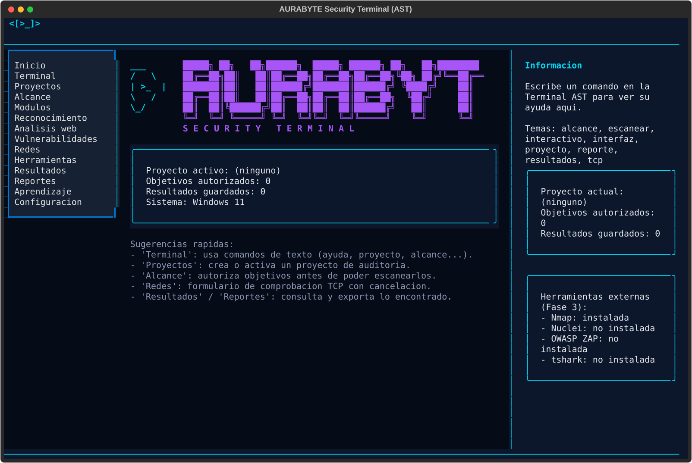

# AURABYTE Security Terminal (AST)

**AST** es una terminal profesional de pentesting y analisis de seguridad, pensada para equipos
que auditan sistemas propios o expresamente autorizados. Es modular, extensible, de codigo
abierto y funciona igual en Windows y Linux. Toda la experiencia de usuario esta en espanol.

> El comando de consola sigue llamandose `est` (abreviatura historica de la Fase 1) y el
> paquete Python se sigue llamando `eurabyte_security`, para no romper instalaciones
> existentes. La marca visible del producto es AURABYTE Security Terminal (AST).

> ⚠️ **Uso autorizado unicamente.** AST solo permite comprobaciones activas (como el escaneo de
> puertos TCP) contra objetivos que hayas registrado explicitamente en el alcance de un proyecto.
> Ver [docs/SEGURIDAD.md](docs/SEGURIDAD.md).



## Dos formas de usar AST

- **`est interactivo`** - terminal de linea de comandos clasica (Fase 1): autocompletado con
  Tab, historial, un comando por linea.
- **`est interfaz`** - interfaz visual completa (Fase 2, construida con
  [Textual](https://github.com/Textualize/textual)): barra lateral de modulos, terminal
  integrada, formularios, tablas de resultados y panel de ayuda contextual, todo con teclado y
  raton.

Ambas comparten exactamente la misma logica interna (`core/`, `commands/`, `storage/`): ninguna
ejecuta comandos a traves de un shell del sistema.

## Caracteristicas

### Fase 1 (MVP)

- Comando principal `est`, con ayuda en espanol (`est --ayuda`).
- Gestion de proyectos de auditoria y de su alcance autorizado (IP/CIDR).
- Comprobacion basica de puertos TCP, controlada: validacion de objetivo, verificacion de
  alcance, limites de concurrencia y de tiempo de espera.
- Persistencia de resultados en SQLite. Generacion de informes en HTML y JSON.
- Explicaciones interactivas de cada comando (`est explicar <tema>`).

### Fase 2 (interfaz visual)

- `est interfaz`: aplicacion Textual real, no una maqueta. Conectada a la misma base de datos y
  a la misma logica que la CLI.
- Barra superior (logo, version, proyecto activo, sistema operativo), barra lateral con las 14
  secciones del roadmap, terminal interactiva integrada con autocompletado contextual y
  sugerencias, paneles dedicados para Proyectos, Alcance, Redes (escaneo TCP con cancelacion),
  Resultados, Reportes, Herramientas (deteccion de Nmap/Nuclei/ZAP/tshark sin ejecutarlos) y
  Configuracion.
- Las secciones todavia no implementadas (Modulos, Reconocimiento, Analisis web,
  Vulnerabilidades, Aprendizaje) se muestran explicitamente como "Proximamente": nunca simulan
  datos falsos.
- Interfaz adaptable: en terminales estrechas oculta el panel de informacion y compacta la
  barra lateral, sin perder acceso a ninguna funcionalidad (sigue disponible desde la Terminal).

Manual de usuario completo (atajos, paneles, solucion de problemas) en
[docs/INTERFAZ.md](docs/INTERFAZ.md).

## Instalacion

Requiere Python 3.11 o superior. Instrucciones detalladas para Windows y Linux en
[docs/INSTALACION.md](docs/INSTALACION.md).

```bash
git clone https://github.com/josedavidosorio2005/Security-Terminal.git
cd Security-Terminal
python -m venv .venv
# Linux/macOS
source .venv/bin/activate
# Windows (PowerShell)
.venv\Scripts\Activate.ps1

pip install -e ".[dev]"
```

## Uso rapido

```bash
est --ayuda
est interfaz                  # interfaz visual completa (Fase 2)
est interactivo                # terminal de linea de comandos (Fase 1)
est proyecto crear laboratorio
est proyecto listar
est alcance agregar 127.0.0.1/32
est escanear tcp 127.0.0.1 --puertos 22,80,443
est explicar tcp
est resultados
est reporte generar --formato html
```

Referencia completa de comandos en [docs/COMANDOS.md](docs/COMANDOS.md).

## Arquitectura

El codigo esta organizado por responsabilidades (CLI, comandos, nucleo, modulos de auditoria,
integraciones, almacenamiento e interfaz, incluida la TUI de Textual). Ver
[docs/ARQUITECTURA.md](docs/ARQUITECTURA.md).

## Roadmap

AST se desarrolla en fases incrementales (MVP, interfaz visual, integraciones con
Nmap/Nuclei/ZAP, asistente de IA, plataforma de plugins). Ver [docs/ROADMAP.md](docs/ROADMAP.md).

## Pruebas

```bash
pytest
ruff check .
```

La suite incluye pruebas de la CLI (Fase 1) y de la interfaz Textual (Fase 2: arranque,
navegacion, autocompletado, formularios, rechazo de objetivos fuera de alcance y adaptacion a
distintos tamanos de terminal), usando el framework de pruebas de Textual (`App.run_test`).

## Contribuir

Ver [CONTRIBUTING.md](CONTRIBUTING.md).

## Seguridad

Ver [SECURITY.md](SECURITY.md) y [docs/SEGURIDAD.md](docs/SEGURIDAD.md) para el modelo de
autorizacion y las restricciones de uso.

## Licencia

MIT. Ver [LICENSE](LICENSE).
