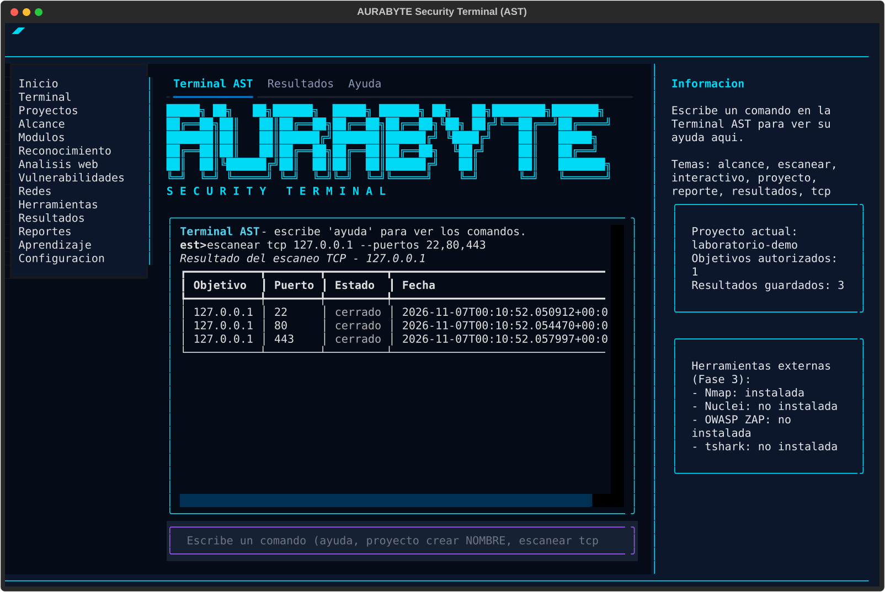
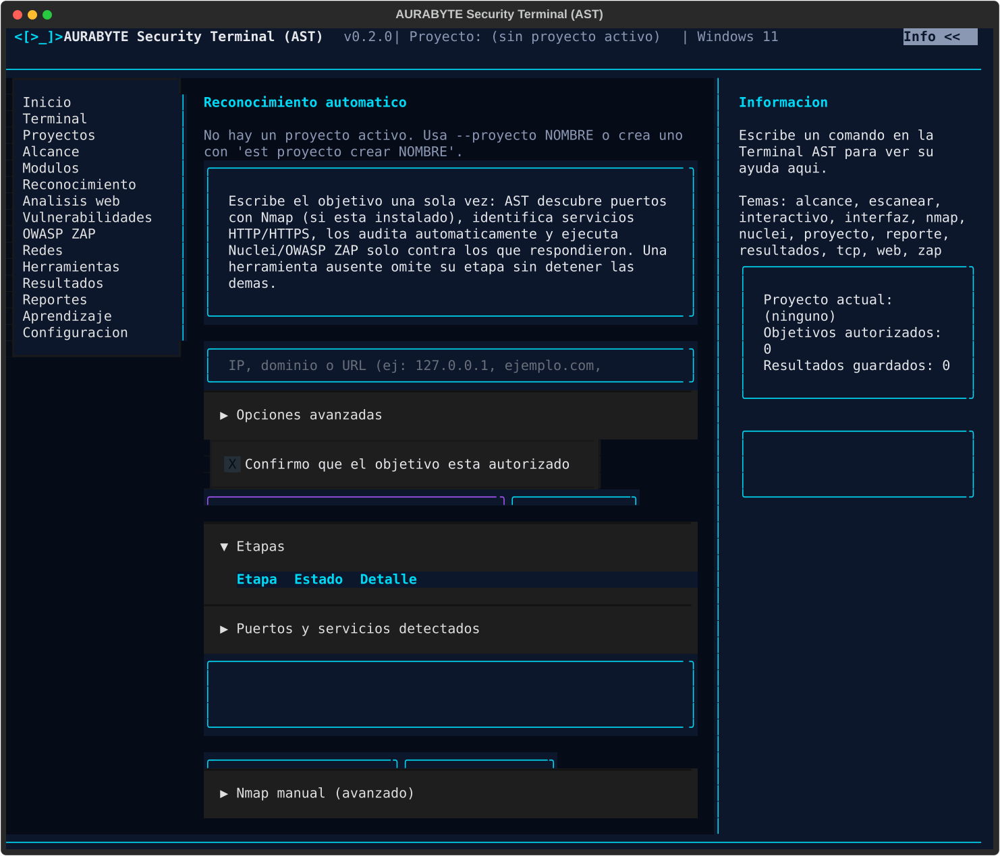
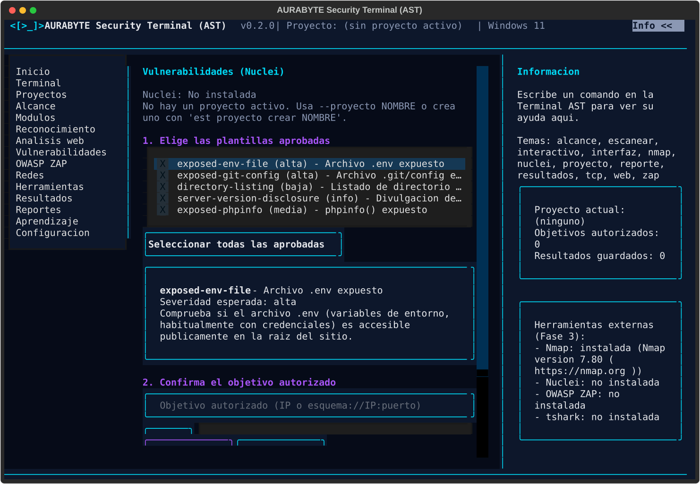

# Manual de la interfaz visual (`est interfaz`)

AST incluye, ademas de la terminal de linea de comandos clasica (`est interactivo`), una
interfaz visual completa construida con [Textual](https://github.com/Textualize/textual). Se
abre con:

```bash
est interfaz
```

Es una aplicacion real: usa la misma base de datos, el mismo alcance autorizado y la misma
logica de validacion que la CLI. No es una maqueta ni una demostracion visual.

## Distribución de la pantalla

- **Encabezado**. Muestra la marca, el proyecto y los accesos a **Menú** e **Info**. La
  versión y el sistema operativo se muestran cuando hay espacio.
- **Menú**. Agrupa las 18 secciones en **Espacio de trabajo**, **Análisis**, **Defensa**,
  **Evidencia** y **Sistema**. Usa las flechas para desplazarte y `Enter` para abrir.
- **Área central**. En Inicio muestra el proyecto activo, el conteo de objetivos y resultados,
  el estado de SQLite y los accesos a las tareas habituales. **Módulos** muestra la función
  y los requisitos de cada módulo técnico.
- **Info**. Muestra la ficha de la sección abierta, el proyecto y la disponibilidad de
  herramientas. En la Terminal también ofrece ayuda sobre el comando que estás escribiendo.
  A partir de 100 columnas se muestra a la derecha por defecto. Debajo de ese ancho,
  `F2` abre la ficha en el área central y `F2` devuelve los controles de la sección.

## Secciones y requisitos

Todos los módulos parten de la misma instalación de AST con Python 3.11 o superior.
Para persistir datos, el usuario necesita acceso de escritura al directorio de AST
(`EST_HOME`, si está configurado). Consulta la [instalación en Windows y Linux](INSTALACION.md).

| Área | Sección | Qué puedes hacer | Qué requiere |
|---|---|---|---|
| Espacio de trabajo | Inicio | Ver el resumen y abrir las secciones más usadas. | Instalación de AST. Para ver datos, selecciona un proyecto. |
| Espacio de trabajo | Terminal | Ejecutar comandos de AST con autocompletado, historial y ayuda. | Depende del comando. Escribe `ayuda` para consultar el listado. |
| Espacio de trabajo | Proyectos | Crear, listar y activar proyectos. | Un nombre único para cada proyecto. |
| Espacio de trabajo | Alcance | Registrar y consultar IP o redes CIDR autorizadas. | Un proyecto activo e IP o redes autorizadas. |
| Espacio de trabajo | Módulos | Consultar funciones y requisitos y abrir cada módulo. | Instalación de AST. |
| Análisis | Análisis web | Revisar cabeceras, TLS, cookies y redirecciones. | Proyecto y URL HTTP(S) con IPv4 autorizada. |
| Análisis | Redes | Comprobar conectividad TCP y guardar el resultado por puerto. | Proyecto activo, IP autorizada y puertos a comprobar. |
| Análisis | Reconocimiento | Consultar el inventario de Nmap y el historial de sesiones. | Para una comprobación nueva, proyecto, objetivo autorizado y Nmap en `PATH`. Nuclei y ZAP son opcionales. |
| Análisis | Vulnerabilidades | Revisar y validar hallazgos de Nuclei. | Para un análisis nuevo, Nuclei en `PATH`, proyecto y objetivo autorizado. |
| Análisis | OWASP ZAP | Revisar alertas de análisis pasivo y registrar su estado. | Para un análisis nuevo, API de ZAP activa en loopback, proyecto, URL autorizada y clave si la API la exige. |
| Análisis | OSINT | Consultar fuentes públicas y recuperar investigaciones guardadas. | Proyecto, Internet para fuentes remotas y autorización para revisar datos personales. Algunos proveedores requieren credenciales opcionales. [Fuentes y requisitos](OSINT.md). |
| Defensa | Tráfico de red | Medir carga y descarga locales y analizar registros de la LAN. | `psutil` viene con AST. Para la LAN, `conn.log` de Zeek en JSON y subredes CIDR. `dns.log`, `http.log` y `ssl.log` aportan dominios observados. |
| Defensa | Operaciones | Documentar casos, vincular evidencia, registrar correcciones y monitorear interfaces locales. | Proyecto activo. Para monitorear, un umbral en Mbps. |
| Evidencia | Resultados | Consultar evidencia y filtrar resultados técnicos por fuente o sesión. | Proyecto activo. La vista se llena con resultados guardados. |
| Evidencia | Reportes | Exportar un informe técnico global en HTML o JSON. | Proyecto activo y acceso de escritura al directorio de reportes. |
| Sistema | Herramientas | Comprobar la disponibilidad de Nmap, Nuclei, ZAP y tshark. | Los binarios deben estar en `PATH`. Para ZAP se comprueba su API local. |
| Sistema | Aprendizaje | Leer las explicaciones integradas en español. | Instalación de AST. |
| Sistema | Configuración | Consultar rutas de datos y cambiar de proyecto. | Para activarlo, el nombre de un proyecto existente. |

Resultados y Reportes reúnen TCP, Nmap, Web, Nuclei y OWASP ZAP. OSINT conserva su
historial e informes en su propio módulo. Operaciones puede exportar el JSON de un caso.

## La Terminal AST

Dentro de la seccion "Terminal" hay tres pestanas:

1. **Terminal AST**: una linea de comandos real, con los mismos comandos que `est interactivo`
   (`proyecto`, `alcance`, `escanear tcp`, `explicar`, `resultados`, `reporte`, `ayuda`).
2. **Resultados**: el mismo panel unificado (las cinco herramientas) que la seccion
   "Resultados" de la barra lateral.
3. **Ayuda**: la documentacion de todos los comandos, siempre visible y desplazable.



### Atajos de teclado en la Terminal

| Tecla | Accion |
|---|---|
| `Tab` | Autocompleta el comando si solo hay una opcion posible (igual que una shell). |
| Mientras escribes | AST sugiere en gris la unica completion posible; `End`/flecha derecha la acepta. |
| `↑` / `↓` | Recorre el historial de comandos escritos en esta sesion. |
| `Enter` | Ejecuta el comando. |

### Atajos generales de la aplicacion

| Tecla | Accion |
|---|---|
| `Tab` / `Shift+Tab` | Mover el foco entre campos (fuera de la Terminal). |
| `↑` `↓` `Enter` | Navegar y seleccionar en la barra lateral y en las tablas. |
| `F1` | Abrir el catálogo de módulos. |
| `F2` | Mostrar u ocultar la ficha de la sección actual. |
| `F3` | Llevar el foco al menú lateral. |
| `F4` | Abrir la Terminal y enfocar la entrada de comandos. |
| `Ctrl+Q` | Salir de la interfaz visual. |

El raton funciona en toda la interfaz: clic en la barra lateral para navegar, clic en botones,
clic en una fila de una tabla para seleccionarla.

## Secciones con formulario

### Proyectos

Crea un proyecto con el campo de texto y el boton "Crear" (o `Enter`). La tabla muestra todos
los proyectos; el activo aparece marcado con `*`. Para activar otro, selecciona su fila (clic o
`Enter`) y pulsa "Marcar seleccionado como activo".

### Alcance

Registra una IP (`127.0.0.1`) o una red CIDR (`192.168.1.0/24`) autorizada para el proyecto
activo. **Ningun escaneo puede ejecutarse contra un objetivo que no este aqui.**

### Redes (comprobacion TCP)

Formulario con objetivo, puertos, timeout y concurrencia. El boton "Escanear" ejecuta la
comprobacion en segundo plano (no bloquea la interfaz); "Cancelar" detiene la espera del
resultado. Si el objetivo no esta en el alcance autorizado, se muestra un error claro y no se
guarda ningun resultado.

### Reconocimiento (automatico)

Pantalla principal de auditoria: escribe el objetivo (IP, dominio o URL) **una sola vez**,
elige un perfil (Rapido, Completo o Personalizado -- "Opciones avanzadas" tiene el campo de
puertos personalizados y el tiempo limite de Nmap), marca "Confirmo que el objetivo esta
autorizado" y pulsa "Iniciar reconocimiento automatico". AST encadena automaticamente Nmap,
deteccion de servicios HTTP/HTTPS, auditoria web, Nuclei y OWASP ZAP -- el mismo motor que
`est reconocimiento ejecutar` (ver [docs/ARQUITECTURA.md](ARQUITECTURA.md) para el flujo
completo) -- sin que tengas que repetir el objetivo en cada panel. El boton "Verificar
objetivo" resuelve y muestra la IP autorizada sin lanzar el analisis completo.

La tabla "Etapas" se actualiza en vivo con el estado real de cada paso (`pendiente`,
`ejecutando`, `completada`, `omitida`, `fallida` o `cancelada` -- nunca un porcentaje
inventado); "Puertos y servicios detectados" y el resumen final aparecen en secciones
plegables para no saturar la pantalla. "Cancelar" detiene el reconocimiento de verdad: las
etapas ya completadas se conservan, las siguientes no se ejecutan. "Ver vulnerabilidades"
lleva directamente al panel "Resultados" ya filtrado a "Solo vulnerabilidades" (web, Nuclei
y OWASP ZAP -- nunca mezcla un puerto abierto de TCP/Nmap con un hallazgo) y a la sesion que
se acaba de ejecutar; "Generar informe" crea el informe global en HTML en cualquier momento.

Si el objetivo es un dominio, las etapas de auditoria web/Nuclei/OWASP ZAP se **omiten**
explicitamente (el resumen final explica por que: AST no puede conservar el `Host`/SNI del
dominio mientras se conecta a la IP ya fijada con las herramientas HTTP actuales); la etapa
de puertos si se ejecuta sobre la IP autorizada.

**Nmap manual (avanzado)**: una seccion plegable, identica al formulario que ya existia
(objetivo, puertos, la casilla de deteccion de servicios/version `-sV` -- dejala desmarcada
salvo que esa comprobacion este explicitamente autorizada), para quien prefiera ejecutar
Nmap por separado sin el resto del flujo automatico. Misma politica de cancelacion real y de
evidencia XML que siempre. Detalle de parametros y limitaciones de Nmap en
[docs/INTEGRACIONES.md](INTEGRACIONES.md).



### Analisis web

Formulario con selector de proyecto (por defecto, el activo), selector de tipo de analisis
(cabeceras, TLS, cookies o auditoria completa), URL del objetivo, tiempo limite y una casilla
"Seguir redirecciones autorizadas". El boton "Analizar" corre la auditoria en segundo plano;
"Cancelar" detiene la peticion en curso sin guardar ningun hallazgo parcial. La URL debe usar
una direccion IPv4 autorizada en el alcance del proyecto elegido (no se admiten nombres de
dominio en esta entrega). Selecciona una fila de la tabla de hallazgos para ver su explicacion
completa (significado, proposito, riesgo, recomendacion y referencia) debajo. Detalle completo
en [docs/AUDITORIA_WEB.md](AUDITORIA_WEB.md).

### Vulnerabilidades (Nuclei)

Muestra si Nuclei esta instalado (y su version) y el proyecto activo. El catalogo de
plantillas aprobadas se presenta como una lista compacta (id, severidad esperada y nombre),
sin la descripcion larga de cada una visible todo el tiempo: navega con las flechas o el
raton para que su descripcion completa aparezca debajo, y marca su casilla (barra
espaciadora o clic) para incluirla en el analisis. El boton "Seleccionar todas las
aprobadas" marca el catalogo completo de una vez. Escribe el objetivo, un tiempo limite
opcional y marca la casilla **"Confirmo que el objetivo esta autorizado"** -- el boton
"Analizar" no hace nada sin esa confirmacion explicita, para que un clic accidental nunca
dispare un analisis real. "Cancelar" detiene el proceso de Nuclei de verdad. Selecciona una
fila de la tabla de hallazgos para ver su detalle completo (severidad, descripcion,
evidencia saneada y recomendacion de mitigacion) y marcarla como "confirmado" o "falso
positivo" -- como con cualquier escaner automatico, revisa la evidencia antes de confirmar
un hallazgo. Igual que "Reconocimiento", rechaza objetivos fuera del alcance autorizado y no
guarda nada si se cancela. Detalle completo (catalogo, limitaciones) en
[docs/NUCLEI.md](NUCLEI.md).



### OWASP ZAP

Muestra si la API de ZAP responde (y su version), el proyecto activo y una nota explicita de
que solo se ofrece analisis pasivo (nunca active scan, spider, ajaxSpider ni fuzzing). Escribe
la URL autorizada, un tiempo limite opcional y marca la casilla **"Confirmo que el objetivo
esta autorizado"** antes de poder analizar -- igual que en "Vulnerabilidades", un clic
accidental en "Analizar" nunca dispara un analisis real. "Cancelar" detiene la espera del
analisis (ZAP sigue corriendo como servicio independiente; lo que AST garantiza es que no se
guarda ningun hallazgo si se cancela). Selecciona una fila de la tabla de alertas para ver su
detalle completo (riesgo, confianza, descripcion, evidencia saneada, solucion y referencia) y
marcarla como "confirmado" o "falso positivo". Igual que "Vulnerabilidades", rechaza objetivos
fuera del alcance autorizado. Detalle completo (configuracion, limitaciones) en
[docs/OWASP_ZAP.md](OWASP_ZAP.md).

### OSINT

Investigacion de fuentes publicas sobre un dominio/empresa, un correo, un telefono o un
nombre de usuario. **Nunca ejecuta un escaneo activo contra el objetivo**: solo consulta
fuentes publicas ya documentadas (DNS, RDAP, Certificate Transparency, APIs publicas de
GitHub/GitLab/urlscan.io y, si estan configuradas, Have I Been Pwned/VirusTotal). Detalle
completo de cada fuente y sus limitaciones en [docs/OSINT.md](OSINT.md).

El formulario (tipo, objetivo, campos condicionales, fuentes, botones) queda siempre
visible encima de los resultados, que tienen su propio scroll independiente: revisar
una pestana con hallazgos extensos nunca empuja "Investigar"/"Cancelar" fuera de
pantalla. En terminales angostas las filas se apilan en vertical (sin recortar ningun
texto) y el encabezado oculta el nombre del proyecto activo para que el indicador de
estado ("Sin investigacion", "Investigando...", "Completada", "Cancelada", "Error" --
nunca una barra de progreso inventada) siempre sea visible.

Elige el tipo de objetivo, escribe el objetivo (el campo de region ISO solo aparece
para telefono), y si es correo/telefono/usuario marca **"Confirmo que el objetivo es
propio o su revision esta autorizada"** -- el boton **"Investigar"** rechaza continuar
sin esa confirmacion para esos tipos (un dominio se trata como informacion corporativa
y no la exige). La seccion plegable "Fuentes a consultar" se repuebla segun el tipo
elegido; si no marcas ninguna, se consultan todas las aplicables. "Cancelar" detiene la
investigacion de verdad: la fuente en curso en ese momento no persiste nada, las ya
completadas se conservan.

En la pestana **Resumen**, el selector **"Investigacion guardada"** permite recuperar
cualquier investigacion anterior del proyecto activo (hallazgos, etapas y resumen) sin
volver a ejecutar nada y sin salir a la CLI -- "Investigacion actual" vuelve a la que se
acaba de ejecutar en esta sesion.

Los resultados se organizan en pestanas:

- **Resumen**: selector de investigacion guardada, estado de cada fuente consultada
  (`pendiente`, `ejecutando`, `completada`, `omitida`, `fallida` o `cancelada` -- nunca
  un porcentaje inventado) y el resumen final (total de hallazgos, indicadores de
  exposicion, limitaciones).
- **Infraestructura**: DNS, RDAP, Certificate Transparency e historial de escaneos.
- **Perfiles publicos**: coincidencias de nombre de usuario (GitHub, GitLab) -- nunca
  se presentan como una identidad confirmada.
- **Exposicion**: brechas conocidas (si `EST_HIBP_API_KEY` esta configurada),
  reputacion de dominio (si `EST_VIRUSTOTAL_API_KEY` esta configurada) y cualquier otro
  hallazgo con un indicador de exposicion.
- **Fuentes**: catalogo completo, con si cada una esta disponible o requiere
  configuracion (y que variable de entorno le falta).
- **Informe**: genera el informe de la investigacion en HTML o JSON, con una casilla
  opcional para minimizar (enmascarar) el objetivo en el archivo exportado.

Selecciona una fila de cualquiera de las tablas de hallazgos para ver su detalle
completo (categoria, nivel de confianza, descripcion, indicador de exposicion y fecha
de consulta) debajo de la tabla.

### Tráfico de red

- **Este equipo** toma una muestra de un segundo y presenta carga, descarga y velocidad por
  interfaz. También lista las aplicaciones con conexiones identificadas al final de la muestra.
- **Registros LAN** indica qué archivos y subredes necesita el análisis. Con `conn.log` muestra
  el consumo por IP local y por servicio. En **Fuentes de dominios** puedes agregar `dns.log`
  para el ranking DNS y `http.log` o `ssl.log` para ver dominios web observados.

Los resultados de ambas vistas se muestran en pantalla. El panel no guarda automáticamente
los archivos ni su contenido en el historial de proyectos. Consulta los formatos y detalles en
[Comandos de tráfico](COMANDOS.md#est-trafico).

### Operaciones

- **Casos** permite abrir un caso con activo, título, gravedad y evidencia inicial. También
  puedes consultar el historial por activo.
- **Cronología** lee el número de caso del encabezado. Permite consultar los eventos,
  vincular resultados del proyecto, registrar acciones y exportar el caso en JSON.
- **Monitoreo** guarda lecturas de las interfaces del equipo en el proyecto activo y señala
  las muestras que superan el umbral de carga o descarga. Puedes iniciar y detener la
  observación y consultar las últimas mediciones.

El número de caso se conserva al cambiar de pestaña. Al cambiar de proyecto, se limpia el
formulario del anterior y se solicita detener su monitoreo.

### Herramientas

Muestra si Nmap, Nuclei y tshark estan instalados en el sistema (`PATH`) y si la API de OWASP
ZAP responde en el endpoint configurado, con la version detectada para Nmap, Nuclei y ZAP.
AST **nunca ejecuta un analisis automaticamente** desde este panel: solo comprueba
presencia/version/disponibilidad, de solo lectura.

### Resultados

Consulta los resultados/hallazgos guardados del proyecto activo, combinando las cinco
herramientas (TCP, Nmap, Web, Nuclei, OWASP ZAP). El primer selector filtra por
herramienta -- incluye la opcion "Solo vulnerabilidades (web+Nuclei+ZAP)" para ver
unicamente hallazgos de seguridad, nunca puertos de TCP/Nmap mezclados con ellos. El
segundo selector filtra por sesion de reconocimiento automatico guardada (o "Todas las
sesiones"): cada sesion filtra por su propia ventana de tiempo, sin mezclar los
resultados de dos sesiones distintas. Pulsa "Actualizar" tras cambiar cualquiera de los
dos, o selecciona una fila para ver su descripcion, evidencia, recomendacion y
referencia completas. Es solo lectura: para marcar un hallazgo de Nuclei u OWASP ZAP
como confirmado o falso positivo, usa sus paneles dedicados ("Vulnerabilidades", "OWASP
ZAP"). Los resultados de TCP y Nmap nunca muestran una severidad (son informacion de
conectividad/puertos, no vulnerabilidades).

### Reportes

Elige el formato (HTML o JSON) y pulsa "Generar". El informe **global** combina las
cinco herramientas (resumen ejecutivo, objetivos/alcance, resultados de red y hallazgos
de vulnerabilidad ordenados por severidad, limitaciones tecnicas). Se guarda en el
directorio de datos de AST y la ruta exacta aparece en pantalla. Los informes
especificos de cada herramienta siguen disponibles desde sus propios comandos (`est
nuclei reporte`, `est zap reporte`, `est web reporte`).

### Configuracion

Muestra las rutas locales (base de datos, historial, directorio de datos) y permite cambiar el
proyecto activo sin volver a la Terminal.

## Interfaz adaptable

Por debajo de 100 columnas, el área de trabajo ocupa el espacio del panel derecho por
defecto. Puedes volver a abrir la ficha con `F2`. Por debajo de 90 columnas, se compacta
el menú lateral. Las secciones largas se desplazan con el teclado o el ratón.


## Solucion de problemas comunes

**"No se pudo iniciar la terminal interactiva en esta consola"** (al usar `est interactivo`, no
`est interfaz`): ocurre cuando la entrada/salida esta redirigida o la consola no es compatible
con prompt_toolkit (por ejemplo, algunas configuraciones de Git Bash/MinTTY en Windows). Abre
`cmd.exe` o PowerShell directamente.

**La interfaz visual (`est interfaz`) se ve con colores o bordes raros**: suele ser una
terminal sin soporte de color verdadero (truecolor). Usa Windows Terminal, un emulador moderno
de Linux, o ajusta su configuracion de colores.

**Un escaneo no aparece en Resultados**: comprueba que el objetivo esta registrado en
"Alcance" para el proyecto activo (indicado en la barra superior e inferior); si no lo esta, el
escaneo se rechaza y no se guarda nada.

**Una seccion dice "Proximamente"**: es intencional. Esa funcionalidad todavia no esta
implementada (ver [docs/ROADMAP.md](ROADMAP.md)); no hay ningun dato real que mostrar ahi
todavia.

**Herramienta externa marcada como "No instalada"**: AST solo comprueba si el binario esta en
el `PATH` del sistema; instalala y vuelve a pulsar "Volver a detectar".

**El panel tarda un instante en mostrar "Instalada"/"Disponible" al entrar**: la
deteccion (version de un binario, o si la API de OWASP ZAP responde) corre en segundo
plano para no congelar la interfaz -- ver "comprobando..." brevemente es normal,
sobre todo al entrar a "OWASP ZAP" sin tener una instancia corriendo (timeout de
conexion de ~2s).

## Cancelacion de un escaneo o analisis: semantica exacta

Al pulsar "Cancelar" en el panel "Redes", "Reconocimiento", "Analisis web",
"Vulnerabilidades" u "OWASP ZAP" (o al iniciarse un escaneo/analisis nuevo mientras otro
seguia en curso):

- La semantica es **todo o nada**: un escaneo o analisis cancelado no guarda ningun resultado
  en la base de datos, ni siquiera de los puertos/hallazgos que ya se habian comprobado antes
  de cancelar, ni evidencia alguna.
- **Redes (TCP)**: deja de abrir conexiones nuevas en cuanto detecta la cancelacion (sondeo
  cada 50ms, no solo cuando un puerto termina), pero las conexiones que ya se habian iniciado
  pueden completarse en segundo plano hasta su propio `--timeout` (limitacion de Python al
  cancelar hilos bloqueados en E/S): simplemente no se usa su resultado.
- **Reconocimiento (Nmap)** y **Vulnerabilidades (Nuclei)**: al cancelar, AST mata el proceso
  externo de verdad (`Popen.kill()`), no se limita a dejar de esperarlo.
- **Analisis web**: deja de leer el cuerpo de la respuesta en cuanto detecta la cancelacion;
  igual que las demas, no persiste ningun hallazgo del analisis cancelado.
- **OWASP ZAP**: deja de esperar al analizador pasivo en cuanto detecta la cancelacion; como
  ZAP es un servicio independiente (no un proceso que AST lance), seguira corriendo por su
  cuenta, pero AST nunca persiste ningun hallazgo de un analisis cancelado.
- Si inicias un segundo escaneo/analisis antes de que termine el primero, el primero se
  cancela automaticamente y solo el resultado del mas reciente puede llegar a mostrarse en la
  tabla: la interfaz nunca mezcla los resultados de dos ejecuciones.

## Limitaciones conocidas

- `est interfaz` necesita una terminal real (no funciona con la entrada/salida completamente
  redirigida), igual que cualquier aplicacion Textual.
- Las secciones Modulos y Aprendizaje son marcadores de posicion para las Fases 3 y 5: no
  tienen funcionalidad todavia (Analisis web, Vulnerabilidades y OWASP ZAP ya estan
  implementadas).
- El escudo de marca (barra superior y panel de Inicio) es una alternativa en texto ASCII
  mientras no exista el recurso grafico oficial (ver `eurabyte_security/marca.py`).
- El panel "Resultados" es de solo lectura/filtrado: marcar un hallazgo de Nuclei u OWASP
  ZAP como confirmado o falso positivo sigue haciendose desde sus paneles dedicados
  ("Vulnerabilidades", "OWASP ZAP"). Ver [docs/INTEGRACIONES.md](INTEGRACIONES.md),
  [docs/NUCLEI.md](NUCLEI.md) y [docs/OWASP_ZAP.md](OWASP_ZAP.md) para el detalle
  especifico de cada herramienta.
- El analisis pasivo de OWASP ZAP no se ha podido validar contra una instancia de ZAP real
  en este entorno de desarrollo (ver limitaciones en [docs/OWASP_ZAP.md](OWASP_ZAP.md)).
