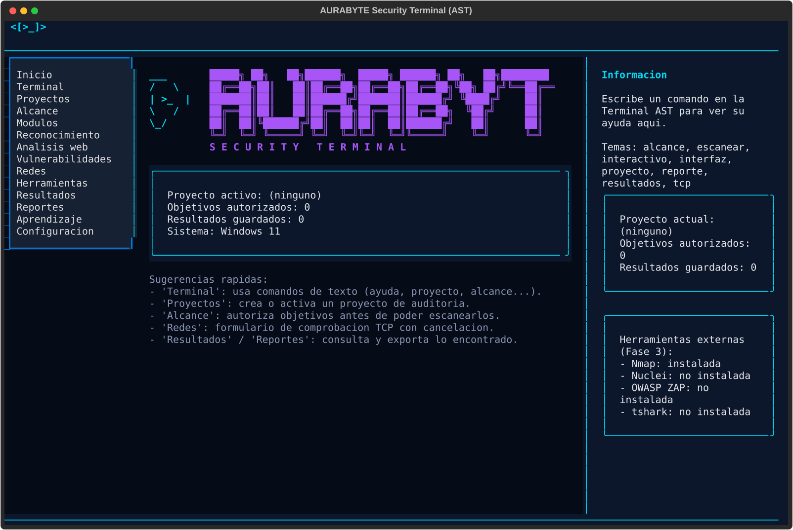
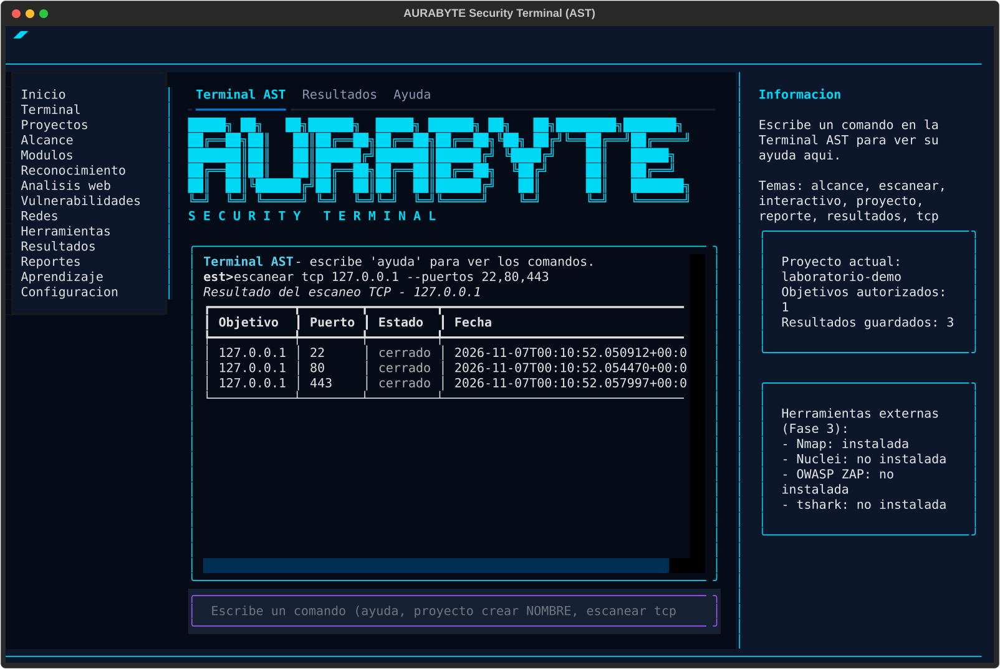
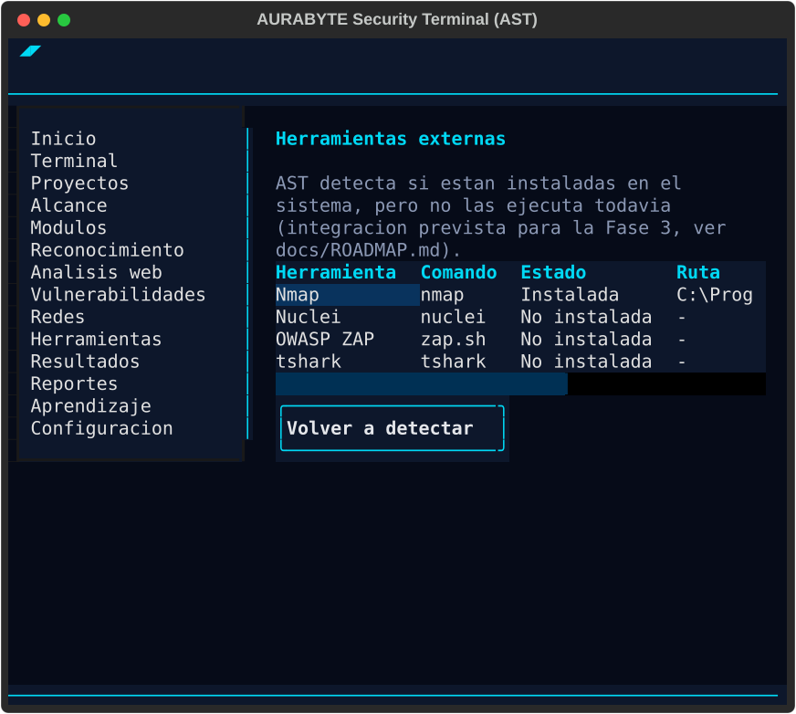

# Manual de la interfaz visual (`est interfaz`)

AST incluye, ademas de la terminal de linea de comandos clasica (`est interactivo`), una
interfaz visual completa construida con [Textual](https://github.com/Textualize/textual). Se
abre con:

```bash
est interfaz
```

Es una aplicacion real: usa la misma base de datos, el mismo alcance autorizado y la misma
logica de validacion que la CLI. No es una maqueta ni una demostracion visual.



## Distribucion de la pantalla

- **Barra superior**: logo, nombre del producto, version, proyecto activo y sistema operativo.
  El logo es un escudo azul/cian con un simbolo de terminal (`>_`) dentro, sin mascotas ni
  robots. Mientras no exista el recurso grafico oficial, se muestra como texto ASCII (ver
  `eurabyte_security/marca.py`), compatible con cualquier terminal de Windows o Linux.
- **Barra lateral izquierda**: navegacion entre las 14 secciones (ver tabla abajo).
- **Zona central**: el contenido de la seccion seleccionada.
- **Panel derecho**: ayuda contextual del comando que estes escribiendo en la Terminal, datos
  del proyecto actual y el estado de las herramientas externas detectadas.
- **Barra inferior**: proyecto activo, objetivos autorizados, resultados guardados y estado de
  la base de datos.

## Secciones de la barra lateral

| Seccion | Estado | Que hace |
|---|---|---|
| Inicio | Implementada | Panel de bienvenida con un resumen del proyecto activo. |
| Terminal | Implementada | Terminal AST (ver abajo), mas las pestanas Resultados y Ayuda. |
| Proyectos | Implementada | Crear proyectos, listarlos y marcar uno como activo. |
| Alcance | Implementada | Registrar y consultar el alcance autorizado (IP/CIDR). |
| Modulos | Proximamente (Fase 3) | Punto de entrada futuro a los modulos de auditoria. |
| Reconocimiento | Proximamente (Fase 3) | Reservado para herramientas de reconocimiento. |
| Analisis web | Proximamente (Fase 3) | Reservado para cabeceras HTTP, TLS, etc. |
| Vulnerabilidades | Proximamente (Fase 3) | Reservado para integraciones como Nuclei. |
| Redes | Implementada | Formulario de comprobacion TCP, con boton de cancelar. |
| Herramientas | Implementada | Detecta si Nmap/Nuclei/OWASP ZAP/tshark estan instalados (no los ejecuta). |
| Resultados | Implementada | Tabla de resultados guardados del proyecto activo. |
| Reportes | Implementada | Genera informes HTML o JSON del proyecto activo. |
| Aprendizaje | Proximamente (Fase 5) | Reservado para laboratorios y contenido educativo. |
| Configuracion | Implementada | Muestra las rutas de datos y permite cambiar el proyecto activo. |

Una seccion marcada como "Proximamente" lo dice explicitamente en pantalla: AST nunca simula
datos ni resultados en una funcionalidad que todavia no existe.

## La Terminal AST

Dentro de la seccion "Terminal" hay tres pestanas:

1. **Terminal AST**: una linea de comandos real, con los mismos comandos que `est interactivo`
   (`proyecto`, `alcance`, `escanear tcp`, `explicar`, `resultados`, `reporte`, `ayuda`).
2. **Resultados**: la misma tabla de resultados que la seccion "Resultados" de la barra lateral.
3. **Ayuda**: la documentacion de todos los comandos, siempre visible y desplazable.



### Atajos de teclado en la Terminal

| Tecla | Accion |
|---|---|
| `Tab` | Autocompleta el comando si solo hay una opcion posible (igual que una shell). |
| Mientras escribes | AST sugiere en gris la unica completion posible; `End`/flecha derecha la acepta. |
| `↑` / `↓` | Recorre el historial de comandos escritos en esta sesion. |
| `Enter` | Ejecuta el comando. |

### Atajos generales de la aplicacion

| Tecla | Accion |
|---|---|
| `Tab` / `Shift+Tab` | Mover el foco entre campos (fuera de la Terminal). |
| `↑` `↓` `Enter` | Navegar y seleccionar en la barra lateral y en las tablas. |
| `Ctrl+Q` | Salir de la interfaz visual. |

El raton funciona en toda la interfaz: clic en la barra lateral para navegar, clic en botones,
clic en una fila de una tabla para seleccionarla.

## Secciones con formulario

### Proyectos

Crea un proyecto con el campo de texto y el boton "Crear" (o `Enter`). La tabla muestra todos
los proyectos; el activo aparece marcado con `*`. Para activar otro, selecciona su fila (clic o
`Enter`) y pulsa "Marcar seleccionado como activo".

### Alcance

Registra una IP (`127.0.0.1`) o una red CIDR (`192.168.1.0/24`) autorizada para el proyecto
activo. **Ningun escaneo puede ejecutarse contra un objetivo que no este aqui.**

### Redes (comprobacion TCP)

Formulario con objetivo, puertos, timeout y concurrencia. El boton "Escanear" ejecuta la
comprobacion en segundo plano (no bloquea la interfaz); "Cancelar" detiene la espera del
resultado. Si el objetivo no esta en el alcance autorizado, se muestra un error claro y no se
guarda ningun resultado.

### Herramientas

Muestra si Nmap, Nuclei, OWASP ZAP y tshark estan instalados en el sistema (`PATH`). AST
**nunca los ejecuta automaticamente**: esa integracion esta prevista para la Fase 3.

### Reportes

Elige el formato (HTML o JSON) y pulsa "Generar". El informe se guarda en el directorio de
datos de AST y la ruta exacta aparece en pantalla.

### Configuracion

Muestra las rutas locales (base de datos, historial, directorio de datos) y permite cambiar el
proyecto activo sin volver a la Terminal.

## Interfaz adaptable

Si reduces el tamano de la terminal, AST se adapta automaticamente:

- Por debajo de ~100 columnas, el panel de informacion (derecha) se oculta.
- Por debajo de ~70 columnas, la barra lateral se compacta.

En ningun caso se pierde acceso a una funcionalidad: lo que deja de verse en un panel lateral
siempre sigue disponible desde la Terminal AST (por ejemplo, `explicar tcp` cumple el mismo
papel que el panel de informacion).



## Solucion de problemas comunes

**"No se pudo iniciar la terminal interactiva en esta consola"** (al usar `est interactivo`, no
`est interfaz`): ocurre cuando la entrada/salida esta redirigida o la consola no es compatible
con prompt_toolkit (por ejemplo, algunas configuraciones de Git Bash/MinTTY en Windows). Abre
`cmd.exe` o PowerShell directamente.

**La interfaz visual (`est interfaz`) se ve con colores o bordes raros**: suele ser una
terminal sin soporte de color verdadero (truecolor). Usa Windows Terminal, un emulador moderno
de Linux, o ajusta su configuracion de colores.

**Un escaneo no aparece en Resultados**: comprueba que el objetivo esta registrado en
"Alcance" para el proyecto activo (indicado en la barra superior e inferior); si no lo esta, el
escaneo se rechaza y no se guarda nada.

**Una seccion dice "Proximamente"**: es intencional. Esa funcionalidad todavia no esta
implementada (ver [docs/ROADMAP.md](ROADMAP.md)); no hay ningun dato real que mostrar ahi
todavia.

**Herramienta externa marcada como "No instalada"**: AST solo comprueba si el binario esta en
el `PATH` del sistema; instalala y vuelve a pulsar "Volver a detectar".

## Cancelacion de un escaneo: semantica exacta

Al pulsar "Cancelar" en el panel "Redes" (o al iniciarse un escaneo nuevo mientras otro seguia
en curso):

- La semantica es **todo o nada**: un escaneo cancelado no guarda ningun resultado en la base
  de datos, ni siquiera de los puertos que ya se habian comprobado antes de cancelar.
- El escaneo deja de abrir conexiones nuevas en cuanto detecta la cancelacion (no se programan
  mas tareas en el `ThreadPoolExecutor`), pero las conexiones que ya se habian iniciado pueden
  completarse en segundo plano hasta su propio `--timeout` (limitacion de Python al cancelar
  hilos bloqueados en E/S): simplemente no se usa su resultado.
- Si inicias un segundo escaneo antes de que termine el primero, el primero se cancela
  automaticamente y solo el resultado del mas reciente puede llegar a mostrarse en la tabla: la
  interfaz nunca mezcla los resultados de dos escaneos.

## Limitaciones conocidas de la Fase 2

- `est interfaz` necesita una terminal real (no funciona con la entrada/salida completamente
  redirigida), igual que cualquier aplicacion Textual.
- Las secciones Modulos, Reconocimiento, Analisis web, Vulnerabilidades y Aprendizaje son
  marcadores de posicion para las Fases 3 y 5: no tienen funcionalidad todavia.
- El escudo de marca (barra superior y panel de Inicio) es una alternativa en texto ASCII
  mientras no exista el recurso grafico oficial (ver `eurabyte_security/marca.py`).
